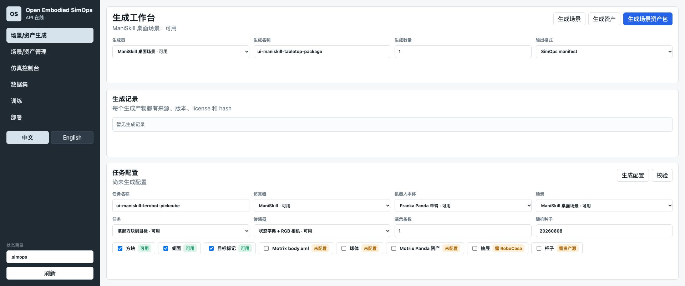

# Open Embodied SimOps

**把机器人仿真、数据集、训练与评测，组织成可追踪的本地工作流。**

中文（默认） · [English](README.en.md) · [架构](docs/architecture.md) · [安全](SECURITY.md) · [参与开发](CONTRIBUTING.md)

面向个人研究者与小型机器人团队的自托管工作台。复用现有仿真器与训练框架，
管理任务配置、命令执行、数据产物与来源记录，不另造物理引擎。

**状态：Alpha，Apache-2.0。** 适合开发者参与和复现，尚非开箱即用的完整机器人生产平台。
API 只应运行在可信本地环境，不要直接暴露到公网。



实际空工作台截图，非 GPU 运行证明。查看 [64 秒双语介绍与下载](https://github.com/eust-w/open-embodied-simops/releases/tag/v0.1.0-alpha.1)。

## 工作流

```text
场景 / 资产 + 机器人 + 任务 + 传感器 + 随机化
                         |
                    仿真与数据采集
                         |
               数据检查 / 合并 / 格式转换
                         |
                    策略训练与评测
                         |
                ROS 2 / LeRobot 接口导出

       声明的产物 -> 来源、版本、license、SHA-256
```

Web 工作台包含生成、资产、仿真、数据集、训练和部署页面，可切换中英文。
任务配置与日志保留在本地，流水线产物记录到 SQLite 和 JSONL。
阶段检查声明的输出是否存在，不等于自动验证输出的科学有效性。

## 当前能力与边界

| 能力 | 实现状态与边界 |
| --- | --- |
| 配置与执行 | YAML 校验、命令适配、日志、失败状态、产物哈希；同一状态目录的流水线串行执行。 |
| 场景与资产 | 内置桌面 manifest 和 MotrixSim 示例打包；不是通用 AI 3D 生成。外部生成器需配置依赖与命令。 |
| 仿真与数采 | 有 ManiSkill PickCube/Panda 路径及 MotrixSim 桥接；需相应运行环境。菜单项不代表所有引擎均已完整集成。 |
| 数据与训练 | 数据检查、合并、转换及 LeRobot 集成；ACT 有历史测试记录，其他组合需单独验证。 |
| 在线预览 | 浏览器预览、渲染帧接口和原生窗口接入代码；原生 MotrixSim 窗口与桥接尚未共享仿真状态。 |
| 部署 | 导出 ROS 2 / LeRobot rollout 接口；尚无可公开复核的真机验收。 |
| 来源追踪 | 记录声明的来源、版本、许可证与哈希；声明不等于法律审查或真实性认证。 |

Genesis、Infinigen、ProcTHOR、EmbodiedGen、RoboCasa 等是集成方向或外部命令接口，
不应全部描述为已经完成端到端验收。详见[发布检查与已知缺口](docs/release/readiness.md)。

## 本地启动

以下启动控制面与 Web 工作台，**不会自动证明 GPU 仿真、训练或机器人可用**。

```sh
git clone https://github.com/eust-w/open-embodied-simops.git
cd open-embodied-simops
python3.11 -m venv .venv
. .venv/bin/activate
python -m pip install -e '.[dev]'
python -m pytest
python -m uvicorn embodied_simops.api:app --host 127.0.0.1 --port 18080
```

打开 <http://127.0.0.1:18080>。测试套件包含测试替身，不代替 GPU 或真机测试。
API 可执行配置中的命令，只加载可信配置。

运行机器人流水线前，准备独立的 ManiSkill/LeRobot 环境，检查并设置
[桌面示例](examples/mvp_maniskill_lerobot_tabletop.yaml) 使用的环境变量与路径，再执行：

```sh
simops validate examples/mvp_maniskill_lerobot_tabletop.yaml
simops run examples/mvp_maniskill_lerobot_tabletop.yaml --state-dir .simops
```

仿真器、模型权重与资产不随本仓库分发。安装辅助工具仍需匹配操作系统、GPU 驱动、
网络和各组件授权；完整环境锁定与干净机器验收仍需补齐。

## 硬件与证据

原设计面向单张 RTX 5880 48GB，建议 128GB 内存、2–4TB NVMe。
这是配置建议，不是所有任务的已测容量保证。不要同时启动训练、3D 生成和大规模仿真；
交互会话与原生窗口尚未纳入统一 GPU 锁。

[2026-06 历史记录](docs/remote-real-test-2026-06-08.md) 记载了 ManiSkill → LeRobot ACT →
仿真评测 → 接口导出的实验。评测使用演示恢复初始状态，不代表未知任务泛化或真机效果。
2026-10-29 发布准备时未能连接历史 GPU 主机，因此没有新的远端验收结论。

## 开源与参与

原创代码使用 [Apache-2.0](LICENSE)。第三方软件、资产和权重遵循各自条款，
请阅读[第三方说明](THIRD_PARTY_NOTICES.md)。MotrixSim 是可选集成，实际版本授权待核实，
不作为本项目的 Apache-2.0 内容分发。

欢迎贡献可复现安装、统一会话状态、全局 GPU 调度和真实集成验收。
提交问题时附版本、脱敏配置和复现步骤；安全问题请遵循 [SECURITY.md](SECURITY.md)。
